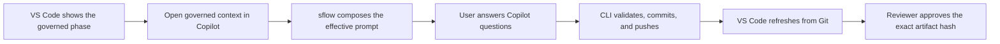

# Native Copilot handoff

Singularity Flow uses the authenticated Copilot surface already available in VS Code or the
terminal. The product does not host a second model session or treat chat history as workflow
state. Native chat is a governed-context handoff, but it is not metered by Singularity Flow.
For qualified metadata-only usage capture, start the launch-owned CLI surface with
`singularity-flow copilot` or VS Code **Continue with Copilot CLI**. Manual `copilot` and
**Open Native Copilot Chat** intentionally remain unmetered.

Run `sflow explain copilot-and-surfaces` for the current boundary between CLI, Copilot, and VS Code. `/sf-home` reads current choices, asks for one explicit selection, follows that guided flow, and refreshes home afterward.

## Operating model



The extension obtains the effective context from:

```bash
sflow wm show-prompt --phase <PHASE>
```

That context combines the phase contract and artifact template, the selected governed agent,
configured prompts/prompt packs, the Repository brief,
rule-selected repository files, pinned remote Markdown, approved upstream
artifacts, and current evidence. The extension passes the composed text to
native Copilot Chat. The equivalent `/sf-*` and `/sflow-*` skills work in Copilot CLI.

The Node.js CLI remains authoritative. It validates ordering, inputs, templates, approvals, and
Git publication. A Copilot response alone never advances the workflow.

## Repository lookup after compaction

An explicit `/sf-code` or `/sf-phase` invocation starts with
`singularity-flow phase enter --for-agent --json`, even when Copilot's cwd is a non-Git chat
folder. `/sf-next`, `/sf-inputs`, and `/sf-review-source` have equivalent single-entry lookups.
The CLI resolves the selected workspace/Story and returns the absolute `repositoryPath`;
the agent must not find the checkout by scanning `/Users`, `$HOME`, or parent directories.
Unavailable selection routes to `/sf-session` or `/sf-workspaces`, not wider discovery.

The installed plugin's hooks add a narrow directory-discovery guard during explicit `/sf-*`
or `/sflow-*` turns. A machine-local session marker retains only skill, session ID and timestamps,
never prompts or attachments. It clears on the next ordinary prompt or session end, expires
after 30 minutes, and is invalidated by a pause change. Native Copilot and paused guidance receive
no repository restriction. In an opted-in turn, bound repository searches and exact external
tool-output file reads remain allowed; edit, test and lifecycle commands are not gated by this
guard. It is not a filesystem sandbox, an approval, or a lifecycle-policy bypass.

Install the updated package/plugin and reload the Copilot host to activate changed hooks and
skill instructions. Direct skills alone carry the bootstrap instruction; hook enforcement
requires the plugin to be loaded by the host.

Plugin hooks use a packaged launcher instead of assuming `singularity-flow` is on the GUI host's
PATH. The launcher resolves Node and a validated SFlow package through PATH applications or fixed
installation prefixes; it never searches repositories, sources a shell profile or downloads a
runtime. A missing/broken runtime returns `SFLOW_HOOK_RUNTIME_UNAVAILABLE` with a human-terminal
installation repair and reload route, rather than the opaque “hook errored”/exit-127 failure.
Nonstandard Node/npm installation prefixes must remain available in the host's PATH.

## Evidence and the Repository brief

Use `/sf-upload` or `/sflow-upload` to register files, directories, screenshots, exported designs,
or HTTPS references. The command reports the stable ID, hash, provider/path, commit, and push.

For revision feedback, use `/sf-revision-attachments` instead of ordinary Story upload. The
current slice stages selected files against the Story and phase: preview their hashes, types,
sizes, extraction status, and selections, then explicitly confirm registration. Registration
alone does not start a revision or put a file in a model packet. In VS Code,
`@sflow /attachments` can preview 1–5 local `file:` references from the exact active Story
worktree and offers a separate registration confirmation. `@sflow /attachments status` and
`@sflow /attachments remove sha256:<SET>` inspect or exclude a set after review. A file visible in Copilot
chat is not governed evidence unless the host exposes its original bytes or a verifiable local
reference. When it does not, the skill reports
`REV_CHAT_ATTACHMENT_UNAVAILABLE` and offers the local-file path; it never turns a chat summary
into a document. PDF/DOCX/image registration is disabled until approved malware scanning and validated
parsing exist. The full `/sflow-revise` execution loop and opaque Copilot attachment-byte bridge are not active in
this slice. Run `sflow explain revision-feedback-attachments` for the exact intake boundary.

The Repository brief a phase receives is read from the source with no build and no model, so it
can be read without an Epic or Story:

```bash
sflow wm brief --phase <PHASE>
```

The brief is guidance; it never blocks or authorizes anything. In VS Code, **World Model Settings**
shows the brief and its source scope; the extension does not own a separate model backend.

Use `/sf-show-prompt` before authoring to see the complete skill and rendered
prompt, including file paths and hashes. See the [glossary](docs/GLOSSARY.md) and
[under-the-hood guide](docs/UNDER-THE-HOOD.md) for the full composition path.

## Native execution performance (SPEC-NCE-001, increments 1–2)

Reuse the explicit skill's authoritative entry rather than preceding it with repeated pause,
workspace or session lookups. `/sf-session` starts with `singularity-flow session open --json`
(or an explicitly chosen Work ID and selectors). That entry checks pause before Git discovery,
preserves selection, and keeps its existing attachment/status checks. Other skills retain their
own entry and fresh operation checks; this is not permission to reuse approval consent.

Audit an exported native host trace, or compare two like-for-like exports:

```bash
npm run audit:copilot -- --trace /absolute/path/before.json
npm run audit:copilot -- --trace /absolute/path/before.json --compare /absolute/path/after.json
```

The exported trace remains `schemaVersion: 1` with an `events` array. Every event requires
`command` and `responseBytes`; `durationMs` is optional. Add observations only when the exporting
host actually measured them:

- `timings`: optional nonnegative millisecond values for `preHookMs`, `startupMs`, `moduleLoadMs`,
  `executionMs`, `postHookMs`, `modelWaitMs` and `gitMs`.
- `counters`: selected existing counter names such as `git.requests`, `git.spawns`,
  `git.fact-cache-hits`, `git.remote.total`, `cli.steps.process-spawns`, and `cli.steps.read-reused`.
  `catalog.scans`, `files.read` and `files.bytes` can be supplied by an instrumented exporter.
  Unknown names are not retained; counters must be nonnegative safe integers.
- `runtimeMode`: `bundled` or `sources` only when observed; omission is `unknown`.
- Optional trace-level `wallClock`: `startedAt` and `completedAt` ISO timestamps with explicit
  timezones. Without them end-to-end latency is unavailable, not the sum of tool durations.

The audit reports sample coverage and nearest-rank p50/p95 for each timing independently. Missing
measurements remain unknown, not zero. Git time can be part of execution time, and hooks or tools
can overlap; never add the layers. Tool-call quantiles are not quantiles of complete Story runs.

To produce comparison differences, both exports must declare matching `benchmark` metadata:

```json
{
  "scope": "command",
  "scenarioId": "session-open",
  "fixtureSha256": "aaaaaaaaaaaaaaaaaaaaaaaaaaaaaaaaaaaaaaaaaaaaaaaaaaaaaaaaaaaaaaaa",
  "platform": "win32",
  "host": "vscode-copilot",
  "temperature": "warm",
  "sampleCount": 30
}
```

The hash above is illustrative: use the digest of the actual reviewed fixture. `scope` is
`command` or `story`; `platform` is `win32`, `darwin` or `linux`; `temperature` is `cold` or `warm`.
`sampleCount` describes independent runs, not tool events. Story comparisons also require the
same workflow and phase order and a reported complete phase journey on both sides. A mismatched
fixture, platform, host, temperature or sample count returns `comparable: false` with no differences
and a nonzero exit status when `--compare` was requested.
Partial service timing cannot establish a complete service-time reduction.

These are observational exports, not receipts, provider accounting, statistical significance or
causal proof. No trace is captured automatically from native Copilot; no billed savings are
inferred. Keep Windows and macOS baselines separate and use at least 30 independent repetitions
for repeatable read benchmarks. Do not use a synthetic/unit-test trace as native-host evidence.

Remaining milestones: further combined-entry adoption, catalog/parser
reuse and batched receipt reads. A local warm service is conditional on measured residual startup
cost; it is not introduced by this increment. All accelerations must preserve current permissions,
independent review, fresh tests, publication boundaries and human confirmation.

### Dedicated plugin hook runtime

The installed launcher prefers the dedicated hook entry, using a matching stamped hook bundle
when available and its source entry otherwise. It dispatches only the four boundary events and
`agent-start`. Boundary decisions use the existing handlers; agent-start shares root/authority,
mapping and trust checks with the CLI. No permission, approval or evidence result is cached here.
Git fact-cache validation, the registered never-model operation context and lease signal cleanup
remain active. Unbound hooks do not load the general CLI or the legacy dispatcher.

Older installations without the dedicated entry retain their existing CLI route. For diagnosis,
`SINGULARITY_FLOW_HOOK_RUNTIME=legacy` selects that verified route rather than disabling hooks.
A present but broken dedicated runtime is not silently downgraded: the launcher keeps its
runtime-unavailable refusal/marker behavior. Inactive Bash/PowerShell shortcuts still avoid Node
entirely. Install the updated build/plugin and reload the host to use the new entry.

Run the isolated, model-free transport benchmark on each target platform:

```bash
npm run benchmark:copilot-hooks -- --samples 30
```

It alternates fresh legacy/dedicated Node processes after warm-up, verifies equal JSON decisions,
and reports p50/p95 plus loaded module counts. It measures unbound hooks and an active explicit
turn with a missing Story contract that must still deny edits. Its private synthetic directory is
removed afterward; inherited Git relocation, workspace selection and Node preload settings are
cleared, so it never runs a model or an existing Story. Loader profiling runs separately
from timed samples. These source-runtime, OS-warm results do not establish Windows, installed-bundle,
complete Story or end-to-end Copilot performance; measure those separately before claiming savings.
