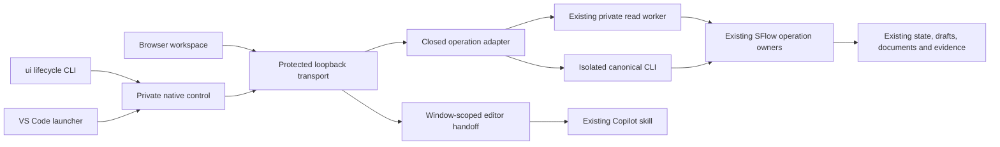

# Local workspace service: implementation and qualification

This branch implements the independent local-service foundation and a working browser draft
journey from SPEC-LWS v1. It does not claim the entire seven-stage rollout or native Windows release.
It is based on current main and does not import or merge the paused Engine SDK branch.

## Ownership

The browser never imports Git/storage/process modules. The HTTP host never imports lifecycle
writers or captures console output. It never changes `process.cwd()`. The adapter constructs a
closed argument vector from typed fields, then uses existing operations with explicit context and
models disabled. The CLI is the compatibility boundary on current main; this does not pretend that
the unmerged Engine SDK is available. Authentication and transport receipts grant no new authority.

The HTTP implementation and assets stay in the installed package's `src/local-ui/` directory.
The small CLI loader resolves this installed path through `PACKAGE_ROOT`; bundling it cannot move
worker/asset URLs into the wrong directory. VS Code's independently lazy 8 KiB bridge budget keeps
the browser feature out of activation and existing panel closures. Prewarming now receives the
caller's existing CLI invoker instead of importing all CLI presentation code again.

## Operation and menu matrix

| Browser interaction | Canonical owner | Scope in this delivery |
| --- | --- | --- |
| Open/status/stop/drain/foreground | `ui` upkeep/read operations; native authenticated lifecycle | Implemented, local Mac tests |
| Overview and context bar | Ticket-bound explicit checkout | Implemented; no Git lookup to draw the landing page |
| Stories search/sort/creator/date | `workspace stories` and its existing index | Canonical read; opaque context selection |
| Create business/technical specification | `spec author new` | Implemented; existing generated IDs |
| Edit title/wording and save | `spec author edit` | Implemented; sequence and stable operation IDs |
| Reconcile an uncertain save | `spec author status --operation-id ID` | Positive proof from verified snapshots; no inference from an absent record |
| Safe preview | Escaped shared-browser presentation | Implemented; no source HTML/remote image execution |
| Check and earlier saves | `spec author check`, `history` | Implemented; checks do not accept or publish |
| Upload/read/restore documents and images | `spec author source`, `sources`; existing private document owner | Implemented, 5 MiB browser upload; canonical fingerprint checks |
| Copilot assistance | Existing `/sf-spec-author` prompt, through the exact window | Prefill only; no live model qualification or execution claim |
| Workflow/agent/skill/instruction catalogs | `workflow list`, `agents list`, `skill list`, `instruction list` | Read adapters; management writes not migrated |
| Decision result | `decisions` | Read adapter; person actions remain native |
| Application/test plans and status | `app plan/status`, `tests plan/summary` | Read adapters; no browser execution control yet |
| About | `about`, service build/runtime handshake | Implemented |
| Person-only accept/publish/sign | Existing native signer and Spec Studio | Explicit native boundary, not a browser approval API |

## Lifecycle and failure behavior

Only the native launcher can grant a checkout context. Browser input never supplies a shell,
arbitrary argv, module name or arbitrary file read path; each browser value reaches the CLI as one
`--name=value` word after the explicit `--context-root=`, so no value ends the options or names another
checkout, and a source link must be http(s). Cookies authenticate the browser; a separate tab handle and
CSRF token isolate tabs. One-use tickets live in fragments and are removed before asynchronous work. A
launcher that opens the browser opens a private 0600 page in the state folder that forwards to the link,
never the link as a process argument; the service removes the page once the link is used or expires.
`ui open|serve|stop` and `spec author … --for-person` are the person's own steps, refused in every chat,
plain chats included; `ui status` is not. Native credentials and discovery are user-owned private files. Host,
Origin, content type, body size, connection, session, worker and queue limits are enforced.

Native control uses HMAC proofs in both directions, replay-bound nonces and AES-GCM sealed inputs.
A foreign listener on a reused port learns neither a bearer credential nor client environment values.
JSON controls are limited to 256 KiB; sealed native environments to 1 MiB; wording to 1 MiB; local
file uploads to 5 MiB; canonical replies to 8 MiB. Wording/uploads use typed binary content routes,
not oversized JSON controls. Activity lists project summaries rather than old artifact bodies.
Canonical stderr, stdout, original errors and progress are redacted (`redactDiagnosticText`) before the
browser sees or a receipt keeps them. Only a service from the launching engine (same path, build
fingerprint and runtime) is reused; the editor loads its bridge from its own selected engine.

Admitted writes are recorded before dispatch. Simultaneous requests with the same ID are admitted
once; changed input is a conflict. Restart preserves interrupted requests as unknown, and a write whose
canonical child was stopped by a signal, had no exit code or gave no JSON answer is unknown, not failed. A timeout is
not a DNS diagnosis or proof of non-execution. A disconnected browser does not kill its admitted
operation. Busy stop refuses; drain finishes admitted work. The service survives its launching
CLI/editor process and stops after its configured idle period when work is quiescent; a tab's status
poll is not activity unless the tab holds unsaved writing.
Admission includes the time spent recording a request; drain cannot release ownership during that
write. Native lifecycle refusals retain typed deadlines/errors and render service-specific recovery.

Read results stay in the service's memory, at most 64, and are never written down. On disk a write
receipt keeps its identity, input binding, outcome and only the identifiers of its result (specification
ID, sequence, operation ID); the newest 128 completed write results are held in full in memory, and older
ones become identity-preserving tombstones that refuse re-enqueue. Records, unknown outcomes included,
are removed at startup seven days after they settled, before the journal is counted; leftover save and
upload folders and opening pages are removed then too. The transport journal has an 8,192-record safety
ceiling; reaching it refuses new browser work and directs inspection of canonical operations, without
deleting workspaces, recovery, source or originals. It is not a
second business-state store. Existing canonical operation IDs and records remain authoritative.

## Qualification and remaining rollout

`test/local-ui.test.mjs` uses isolated homes, private metadata, temporary Git repositories and real
canonical commands. It covers authentication, Host/Origin/CSRF, one-use tickets, same-browser tab
isolation, exact contexts, concurrent admission, original errors, slow-owner responsiveness,
stale saves, canonical parity, interrupted writes, independent process lifetime, local originals,
matching re-upload, image content permissions, and window-specific handoff without model claims.
It also executes a real Chromium create/edit/preview/save/reload journey.

Executed locally on macOS arm64 with Node 26.12.0:

| Qualification | Result |
| --- | --- |
| Service/browser and editor adapter suites | 18 passed; real headless Chromium and canonical draft/source operations |
| Packaged CLI, asset inclusion and foreground lifecycle | 3 passed; fixed installed-package asset paths |
| Existing phase/skill mutation contracts | 125 passed; native browser grants remain unavailable to model turns |
| VS Code runtime budgets, including the slow build/concurrency cases | 5 passed; existing ceilings unchanged |
| Existing Spec Studio library and CLI bundle regressions | 11 and 4 passed, respectively |
| Command, operation, architecture, prewarm, sidebar and isolation regressions | Passed; conditional bundle cases were executed separately above |
| TypeScript and deterministic project check | Passed; 3,774 project checks |

The packaged startup/status/static-page probe observed zero Git children. One run under concurrent
qualification load measured 2,409 ms for a fresh CLI/service open and 1.37 ms median for health.
These are observations with normal OS caches, not a matched cold-disk benchmark or a performance
guarantee. VS Code's new browser adapter is 5,089 bytes/two modules; its prewarm entry is 3,945
bytes/three modules against its unchanged 114,803-byte/25-module ceiling. Bundle size does not
establish native Copilot latency gains. No limits or authority gates were waived.

These are targeted checks for this delivery, not the complete product release suite. The editor
adapter uses a mocked VS Code API with the actual service; it does not establish a native editor-host
launch or live Copilot run. Drain the development service before replacing its checkout/build;
automatic installer continuity remains in the next rollout stages.

Remaining release scope from the original plan:

- Complete browser Spec Studio research/gap/proposal/revision/publication interactions, including
  the existing qualified human signer and full loss/conflict journeys.
- Browser management edits/imports/activation, intake/configuration and full reviews/analytics.
- Run & Test process control, durable reconnection and safe installer drain/artifact retention.
- Native VS Code-host browser opening qualification, accessibility audit and cross-browser matrix.
- Native Windows ACL/process lifetime and packaging qualification, and any remote/embedded mode.

Windows CI and live Copilot runs are not authorized in this task. The launcher refuses unqualified
Windows/remote modes explicitly. Local Mac results do not qualify those modes or a complete v1 release.
